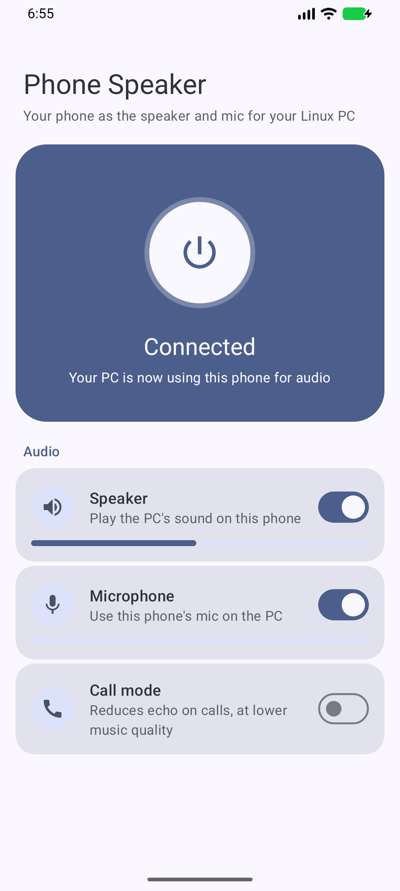

# Phone Speaker

Use your Android phone as the speaker and microphone for your Linux PC, over a USB cable.



- **Speaker:** PC audio plays on the phone (48 kHz, 16-bit, stereo)
- **Microphone:** the phone's mic becomes an input on the PC (48 kHz, 16-bit, mono)
- **Quick Settings button:** turn it on or off without opening the app
- **Small daemon:** about 2 MB of memory on the PC, plus the `adb` server

While connected, "Phone Speaker" and "Phone Mic" become the PC's default devices. When you turn the
app off, they disappear and the PC goes back to your previous devices.

## Requirements

**PC:** Linux with PipeWire and WirePlumber, plus `adb`, `gcc` and `make`. The `pw-record`, `pw-play`
and `pw-metadata` commands must be available.

**Phone:** Android 10 or newer with USB debugging turned on.

## Install

### 1. Install the daemon on the PC

```bash
git clone https://github.com/Kelvinlby/phone-speaker.git
cd phone-speaker/linux
make install
```

This installs `phone-speakerd` to `~/.local/bin` and enables it as a systemd user service.

The service looks for `adb` at `~/Android/Sdk/platform-tools/adb`. If yours is somewhere else (check
with `command -v adb`), run `systemctl --user edit phone-speakerd` and add:

```ini
[Service]
Environment=ADB=/usr/bin/adb
```

Then run `systemctl --user restart phone-speakerd`.

**To start at boot rather than at login,** run `loginctl enable-linger "$USER"`. This also makes your
other systemd user services start at boot.

### 2. Install the app on the phone

Download `app-release.apk` from the [latest release](https://github.com/Kelvinlby/phone-speaker/releases/latest), then:

```bash
adb install app-release.apk
```

### 3. Turn on USB debugging

1. Go to **Settings → About phone** and tap **Build number** 7 times. On some phones it's under
   **Software information**.
2. Go to **Developer options** and turn on **USB debugging**.
3. Plug the phone in and accept the **Allow USB debugging** prompt.

## Use

1. Open **Phone Speaker** and tap the power button.
2. Allow the microphone and notification permissions.
3. Play something on the PC. It should now come out of the phone.

To add the Quick Settings button, tap **Add to Quick Settings** in the app. You can also add
**PC Audio** by editing your Quick Settings panel.

| Setting | What it does |
|---|---|
| **Speaker** | Plays PC audio on the phone |
| **Microphone** | Sends the phone's mic to the PC |
| **Call mode** | Uses Android's voice processing to reduce echo. Leave it off for music. |

If you unplug the cable while the app is on, it waits and reconnects when you plug it back in.

## Troubleshooting

Stuck on **Waiting for PC**? Check these on the PC:

```bash
systemctl --user status phone-speakerd   # Is the daemon running?
journalctl --user -u phone-speakerd -f   # What does it see?
adb devices                              # Should say "device" next to your phone
adb reverse --list                       # Should list tcp:47100
```

| `adb devices` shows | Fix |
|---|---|
| `unauthorized` | Accept the prompt on the phone |
| `no permissions` | Install your distro's Android udev rules. On Ubuntu: `sudo apt install android-sdk-platform-tools-common` |
| Nothing | Try another cable, and check that USB debugging is on |

## Known limitations

- **Other apps on the phone can connect.** While the USB tunnel is up, any phone app with internet
  permission can connect to the same local port. It could hear PC audio or send fake mic audio. There
  is no pairing step yet, so only use this on a phone whose apps you trust.
- **USB debugging must stay on.** The connection runs through `adb reverse`.
- **Echo.** With the speaker and mic both on, the mic hears the speaker. Use Call mode for calls.
- **Wired only.** There is no Wi-Fi support.

## How it works

```
Linux PC                                          Android phone
apps → Phone Speaker → pw-record ┐               ┌→ AudioTrack  → speaker
                                 phone-speakerd ⇄ adb reverse ⇄ app
apps ← Phone Mic ←── pw-play ────┘               └← AudioRecord ← mic
```

The daemon sleeps until the app connects, and audio processes run only during a session. Audio is
uncompressed, and anything that can't be delivered in time is dropped rather than queued, so delay
can't build up.

The protocol is one TCP stream on `127.0.0.1:47100`:

| Direction | Data |
|---|---|
| Phone → PC | Header: `PSPK`, version `1`, flags (`1` speaker, `2` mic) |
| PC → phone | Acknowledgement: `PSOK` |
| PC → phone | s16le, 48 kHz, stereo, while the speaker is on |
| Phone → PC | s16le, 48 kHz, mono, while the mic is on |

## Build from source

The app needs JDK 17 or newer and the Android SDK with API 37:

```bash
cd android
echo "sdk.dir=$HOME/Android/Sdk" > local.properties
./gradlew assembleDebug
adb install app/build/outputs/apk/debug/app-debug.apk
```

Release builds read their signing key from `~/.config/phone-speaker/signing.properties`, which is not
part of this repo. Without that key, use the debug build. A debug build can't update the released app,
so uninstall the released app first.

To test the daemon without a phone, run `python3 linux/test_bridge.py` while the daemon is running.
It briefly changes your default audio devices, but nothing plays out loud.

## Uninstall

```bash
cd linux && make uninstall
adb uninstall com.kelvin.phonespeaker
```

## License

[MIT](LICENSE)
